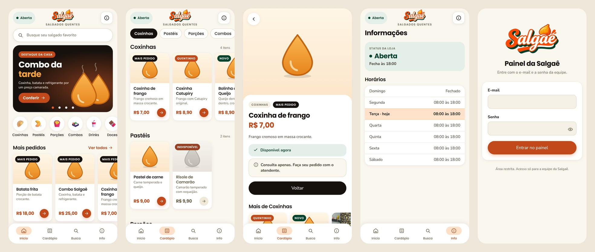
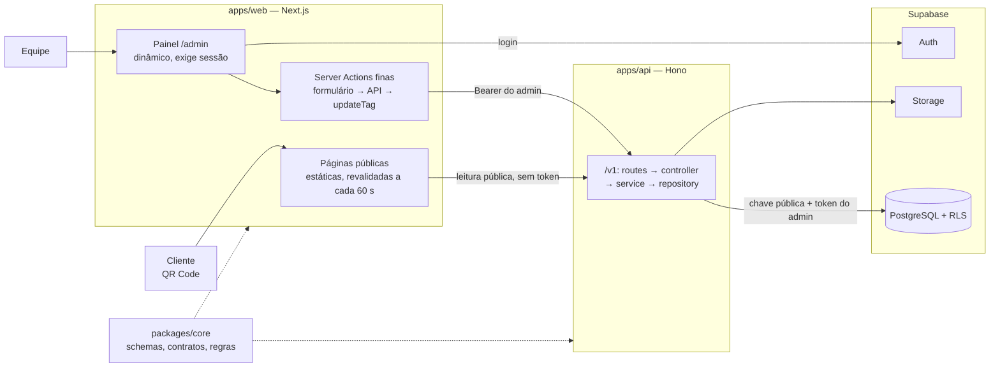

# Salgaê Lanchonete — cardápio digital

Cardápio digital de **consulta no local** para uma lanchonete: o cliente aponta a câmera para um QR Code na mesa, vê os produtos com foto, vídeo curto, preço e disponibilidade, e faz o pedido com o atendente. A equipe mantém tudo por um painel administrativo feito para o celular.

**Demonstração:** <https://salgae-producao.vercel.app> · **Stage (com conteúdo de exemplo):** <https://salgae-homologacao.vercel.app>



> Este repositório não inclui delivery, carrinho, checkout nem pagamento. O cardápio é só de consulta: _"Consulta apenas. Faça seu pedido com o atendente."_

## O que o sistema faz

**Para o cliente**

- Início com carrossel de destaques, atalhos de categoria e os mais pedidos.
- Cardápio completo por categoria, com selos (`MAIS PEDIDO`, `NOVO`, `QUENTINHO`) e itens indisponíveis sinalizados.
- Página do produto com foto, vídeo curto sem som e outros itens da mesma categoria.
- Busca por nome, ingrediente ou categoria, sem depender de acento ou maiúscula.
- Situação da loja (aberta ou fechada) calculada a partir dos horários, com horários e contatos.

**Para a equipe**

- Produtos, categorias e destaques: criar, editar, ordenar, ativar e desativar.
- Situação única por produto: no cardápio, indisponível ou oculto.
- Envio de foto e de vídeo com otimização automática.
- Dados e horários da loja, com abrir ou fechar manualmente em dois toques.
- Registro de auditoria das alterações feitas no painel.

## Tecnologias

| Camada | Tecnologia |
| --- | --- |
| Site (`apps/web`) | Next.js 16 (App Router, Server Components e Server Actions), React 19, TypeScript estrito |
| API (`apps/api`) | Hono sobre Node.js 22, empacotada com esbuild; roda na Vercel ou em Docker |
| Regras comuns (`packages/core`) | Zod, contratos da API e regras puras, sem framework |
| Estilo e movimento | Tailwind CSS 4 e Motion (`motion/react-m` com `LazyMotion`) |
| Dados | Supabase: PostgreSQL com Row Level Security, Auth e Storage |
| Mídia | `sharp` (WebP) e `ffmpeg` (H.264) |
| Qualidade | Vitest, Playwright com axe, ESLint, Prettier, knip, GitHub Actions |
| Hospedagem | Vercel, um projeto por ambiente |

## Arquitetura

O site só desenha a tela. Tudo o que lê ou grava dados passa pela API, a única peça que fala com o banco (o site usa o Supabase apenas para o login).



Organização das pastas (monorepo com npm workspaces):

```
apps/
  web/          site: cardápio e painel, só tela (@salgae/web)
  api/          API: leitura pública e escrita do painel (@salgae/api)
packages/
  core/         schemas Zod, contratos da API, tipos do banco e regras puras (@salgae/core)
e2e/            testes de ponta a ponta com Playwright, web + API juntos (@salgae/e2e)
supabase/       migrations, seed e testes SQL
docs/           documentação técnica; Salgae_Lanchonete_Obsidian/ — vault do projeto
```

### API em camadas

Cada domínio (`menu`, `products`, `categories`, `highlights`, `store`, `media`, `session`) é uma pasta em `apps/api/src/modules/` com quatro camadas, e a dependência sempre aponta para dentro:

| Arquivo | Faz | Não faz |
| --- | --- | --- |
| `x.routes.ts` | liga o caminho ao controller | regra, banco |
| `x.controller.ts` | traduz HTTP: valida a entrada com o schema do core, chama o service, devolve status e JSON | regra, banco |
| `x.service.ts` | regra de negócio; define a interface do repositório de que precisa | importar Hono ou Supabase |
| `x.repository.ts` | implementa essa interface com o Supabase | regra |
| `x.module.ts` | monta repository → service → controller, sem framework de injeção | — |

O que é comum fica em `apps/api/src/shared/`: erros de domínio e sua tradução para HTTP, autenticação do admin, `request-id`, CORS, tempo limite de 15 s e a fábrica do cliente Supabase. O ESLint barra os imports que quebrariam as camadas (controller importando repository, service importando Hono ou Supabase, API importando React ou Next).

### Site por funcionalidade

```
apps/web/src/
  app/              rotas do Next.js (páginas e layouts), sem regra
  features/<x>/     components/ (tela), server/ (Server Actions finas e leituras),
                    client/ (navegador sem tela), hooks/, rules/ (regras só de tela)
  components/       ui/ (botões, campos) e motion/ (provider e primitivas do Motion)
  hooks/            hooks comuns (hidratação, media query)
  lib/              api/ (clientes público e do admin), supabase/ e auth/ (login),
                    cache/, security/ (CSP), seo/, qr/
  proxy.ts          renovação da sessão, só em /admin
```

O ESLint do site também guarda as fronteiras: `@supabase/*` só em `lib/supabase` e `lib/auth`, nada de `sharp`/`ffmpeg-static` (exceto o vídeo, até ele ir para a API) e o Motion só por `motion/react-m`. O `packages/core` não pode importar framework, banco nem os apps.

### Convenção de nomes

- Código em **inglês**: identificadores, arquivos e pastas internas (`listMenu`, `deleteCategory`, `products.service.ts`). Funções começam com verbo; nada de `data`, `handle`, `utils` ou `helpers` genéricos.
- Tela e URLs públicas em **português**: textos, mensagens e rotas (`/cardapio`, `/produto/...`).
- Testes descrevem o comportamento numa frase em português ("não apaga categoria com produtos"), um comportamento por teste.

## Rotas

| Rota | O que é |
| --- | --- |
| `/` | Início: destaques, categorias e mais pedidos. |
| `/cardapio` | Lista completa por categoria. |
| `/produto/[slug]` | Detalhe do item pelo nome (ex.: `/produto/coxinha-de-frango`), com vídeo opcional. Endereços antigos por id redirecionam para o novo. |
| `/busca` | Busca por nome, ingrediente ou categoria. |
| `/info` | Situação da loja, horários e contatos. |
| `/admin` | Resumo do painel e itens que precisam de atenção. |
| `/admin/produtos`, `/admin/categorias`, `/admin/destaques` | Cadastro, situação e ordenação. |
| `/admin/loja` | Dados e horários da loja. |

## Decisões técnicas

**A autorização final é do banco.** Toda ação do painel confere o administrador na aplicação (`requireAdmin`) e de novo no PostgreSQL, por políticas de RLS que consultam `private.is_admin()` — uma função fora do esquema exposto pela API. A aplicação usa só a chave pública; a `service_role` não existe no projeto. Se uma verificação da aplicação for esquecida, o banco ainda recusa a escrita.

**Páginas públicas estáticas, painel dinâmico.** O cardápio é gerado estaticamente e revalidado a cada 60 segundos. As leituras públicas vão à API com etiquetas de cache (`menu`, `store`, `product:<slug>`), e cada alteração no painel chama `updateTag` na Server Action: quem alterou vê o resultado na hora. O visitante nunca espera o banco. O "aberta ou fechada" é recalculado no navegador, porque uma página em cache não sabe que horas são.

**API fora do ar não estraga o cardápio.** O cliente público da API desiste depois de 10 segundos e **lança** o erro em vez de publicar uma tela de erro: no build a publicação falha, e no ISR o Next mantém a última versão boa. O CI derruba a API de propósito (`e2e/scripts/api-fora-do-ar.sh`) para conferir isso.

**Sem segredo novo.** A API usa a mesma chave pública do site e, nas escritas, um cliente Supabase por requisição com o token do administrador. A RLS continua sendo a última barreira.

**Fotos em duas variantes.** O navegador reduz a foto antes de enviar; o servidor valida pelo conteúdo, remove metadados e gera WebP `card` (até 640 px, meta de 80 KB) e `detail` (até 1600 px, meta de 300 KB). O banco guarda só a base do caminho e a interface escolhe a variante.

**Vídeo sempre leve.** O arquivo bruto vai direto do navegador para um bucket privado por URL assinada. Uma rota do servidor confere o tipo real pela assinatura do arquivo, compacta com `ffmpeg` (H.264, até 720p, sem áudio, `faststart`) e publica o resultado, tipicamente de dezenas de megabytes para 1 a 3 MB. O bruto e os temporários são apagados sempre, com sucesso ou com erro.

**Troca de mídia sem deixar item quebrado.** O arquivo novo é enviado, o registro passa a apontar para ele e só então o antigo é apagado — e apenas se nenhum outro registro o usar. Se a gravação falhar, o arquivo novo é removido e o item continua como estava.

**Reordenação atômica.** Trocar dois itens de posição é uma única instrução no banco, por uma função SQL. Ou as duas posições mudam, ou nenhuma.

**Preço em centavos.** O preço é um inteiro (`price_cents`), sem ponto flutuante; a conversão de e para "R$ 8,90" fica em duas funções testadas no `packages/core`.

**Movimento sem custo de acessibilidade.** O Motion entra por um provider de cliente com `MotionConfig reducedMotion="user"` e `LazyMotion strict`, carregando os recursos sob demanda. Só `opacity` e `transform` são animados, nada nasce invisível no HTML do servidor e, no painel, a gaveta ou a confirmação que está saindo fica `inert` e `aria-hidden` até sumir.

## Qualidade

- 306 testes unitários e de integração com Vitest (`npm test`): 95 na API (services com repositório falso e rotas com `app.request()`), 171 no site e 40 no core. Cada pacote tem um piso de cobertura próprio, medido no CI.
- Testes de RLS em SQL (`supabase/tests/`), que rodam dentro de uma transação desfeita no fim e conferem o que visitante, usuário comum e administrador conseguem ler e escrever.
- 125 execuções de ponta a ponta com Playwright (`e2e/`), contra os builds de produção da API e do site: cardápio no celular e no computador, painel, foto e vídeo, cache, API fora do ar, sessão, acessibilidade com axe e movimento com e sem `prefers-reduced-motion`.
- CI no GitHub Actions a cada PR, em dois jobs. O primeiro confere formatação, lint, typecheck, `knip` (arquivos, exports e dependências sem uso), testes e o build da API. O segundo sobe o Supabase local, aplica as migrations num banco vazio, confere os tipos versionados, roda os testes de RLS, sobe a API, faz o build do site lendo dela e roda os testes de ponta a ponta.
- Acessibilidade tratada como requisito: navegação por teclado, foco preso e devolvido nas camadas do painel, rótulos para leitor de tela e respeito a movimento reduzido.
- Cabeçalhos de segurança (`Content-Security-Policy`, `HSTS`, `X-Frame-Options`, `nosniff`, `Referrer-Policy`, `Permissions-Policy`) e páginas de stage fora dos buscadores. A CSP (`apps/web/src/lib/security/csp.ts`) só aceita scripts do próprio site, e os testes de ponta a ponta falham se alguma página tiver algo bloqueado por ela.
- Erros registrados como uma linha JSON, com evento e código, no site e na API (cada resposta da API leva um `request-id`).
- Dependabot abre, toda segunda-feira, PRs de atualização para a `develop`; eles passam pelo mesmo CI.

## Executar localmente

São três peças: o Supabase, a API e o site. Requisitos: Node.js 22 ou superior e um projeto Supabase (o de stage serve para desenvolver; com Docker, `npx supabase start` sobe um local).

```bash
npm install
cp apps/api/.env.example apps/api/.env
cp apps/web/.env.example apps/web/.env.local
```

Preencha nos dois arquivos a URL e a chave anônima/publicável do mesmo projeto Supabase. Nunca use uma `service_role`.

| Peça | Variáveis |
| --- | --- |
| API (`apps/api/.env`) | `SUPABASE_URL`, `SUPABASE_ANON_KEY`, `WEB_ORIGIN` (origem do site, para o CORS) e `PORT` (padrão 4000) |
| Site (`apps/web/.env.local`) | `NEXT_PUBLIC_SUPABASE_URL`, `NEXT_PUBLIC_SUPABASE_ANON_KEY` (login), `API_URL` (servidor e build) e `NEXT_PUBLIC_SITE_URL` |

Depois, em dois terminais, a API primeiro (o site lê os dados dela):

```bash
npm run dev:api
```

```bash
npm run dev
```

O build de produção do site também precisa da API no ar, porque as páginas públicas são geradas com os dados dela.

| Comando | Finalidade |
| --- | --- |
| `npm run dev:api` / `npm run dev` | API e site em desenvolvimento. |
| `npm run build -w @salgae/api` / `npm run start -w @salgae/api` | Build e execução da API. |
| `npm run build` / `npm run start` | Build de produção do site e execução dele. |
| `npm run lint` | ESLint em todos os pacotes. |
| `npm run typecheck` | TypeScript estrito em todos os pacotes. |
| `npm run knip` | Arquivos, exports e dependências sem uso. |
| `npm test` / `npm run test:coverage` | Vitest em todos os pacotes, com ou sem cobertura. |
| `npm run test:db` | Testes SQL de RLS, Storage e reordenação contra o Supabase local. |
| `npm run test:e2e` | Testes de ponta a ponta com Playwright, contra os builds de produção. |
| `npm run test:types-db` | Confere os tipos versionados contra os gerados do banco local (usado no CI). |
| `npm run format` / `npm run format:check` | Formata ou confere a formatação com Prettier. |

### Servidor próprio (VPS)

A API tem um `Dockerfile`, com contexto na raiz do repositório porque ela embute o `packages/core`:

```bash
docker build -f apps/api/Dockerfile -t salgae-api .
docker run -d --restart unless-stopped -p 127.0.0.1:4000:4000 \
  -e SUPABASE_URL=... -e SUPABASE_ANON_KEY=... -e WEB_ORIGIN=https://cardapio.exemplo.com \
  salgae-api
```

O site roda com Node na mesma máquina, com a API no ar antes do build:

```bash
npm ci
API_URL=http://127.0.0.1:4000 npm run build
API_URL=http://127.0.0.1:4000 npm run start
```

Na frente dos dois, um proxy reverso (Nginx ou Caddy) com HTTPS. A API pode ficar só na rede interna; quando o envio de vídeo passar para ela, o navegador também vai chamá-la (`NEXT_PUBLIC_API_URL`).

## Banco de dados

As migrations ficam em `supabase/migrations/` e são aplicadas pelo GitHub Actions, com a CLI do Supabase: no stage, a cada merge na `develop`; em produção, por um passo manual antes da promoção, e o PR para a `main` é reprovado enquanto a produção não tiver a migration. O passo a passo e a configuração dos segredos estão em [Migrations pelo CI](docs/migrations-pelo-ci.md).

O mesmo comando funciona à mão, se for preciso:

```bash
npx supabase login
npx supabase link --project-ref <ref-do-projeto>
npx supabase db push
```

| Migration | O que faz |
| --- | --- |
| `20261008222757_initial_schema` | Categorias, produtos, destaques, perfis e auditoria, com RLS. |
| `20261008225427_harden_rls` | Move `is_admin()` para um esquema privado e deixa uma política por papel e ação. |
| `20261008232020_store_settings` | Dados únicos da loja: horários, contatos e aviso. |
| `20261009103822_product_badge` | Selos do produto. |
| `20261009121148_media_storage` | Buckets públicos de imagens e vídeos e suas políticas. |
| `20261011003026_video_compression_storage` | Bucket privado para o vídeo bruto e limite de 4 MB no publicado. |
| `20261013151000_atomic_sort_order_swap` | Funções de troca de posição em uma única instrução. |

`supabase/seed.sql` traz dados de exemplo para ambiente local ou stage. Não execute o seed em produção.

Os tipos do banco ficam em `packages/core/src/database/database.types.ts`. O arquivo é gerado pelo Supabase a partir do esquema; depois de uma migration nova, gere de novo (`npx supabase gen types typescript --project-id <ref-do-projeto> > packages/core/src/database/database.types.ts`) em vez de editar à mão. A API e o site recebem esse tipo, então um nome de tabela, coluna ou função errado vira erro no `npm run typecheck`.

### Primeiro administrador

1. Crie o usuário em **Authentication > Users** no Supabase.
2. No SQL Editor, crie o perfil inativo:

```sql
insert into public.profiles (id, name, role, is_active)
values ('UUID_DO_USUARIO', 'Nome do responsável', 'admin', false)
on conflict (id) do nothing;
```

3. Depois da conferência, ative-o:

```sql
update public.profiles
set role = 'admin', is_active = true
where id = 'UUID_DO_USUARIO';
```

Não há trigger que promova alguém automaticamente.

## Ambientes

| Ambiente | Branch | Banco | Endereço |
| --- | --- | --- | --- |
| Desenvolvimento | qualquer | stage | `npm run dev` |
| Stage | `develop` | SALGAE-STAGING | <https://salgae-homologacao.vercel.app> |
| Produção | `main` | SALGAE-PRODUCTION | <https://salgae-producao.vercel.app> |

Toda mudança entra por PR na `develop`, é conferida no stage e só então é promovida para a `main`.

## Vídeo: detalhes

| | Entrada (o que o painel aceita) | Saída (o que o cliente baixa) |
| --- | --- | --- |
| Formato | MP4, MOV (iPhone) ou WebM; H.264, HEVC, VP9… | MP4 H.264 (High, nível 3.1), 8 bits |
| Tamanho | até 50 MB | até ~3 MB para 15 s (teto de 4 MB) |
| Duração | até 15 s (tolerância de 0,5 s) | a mesma |
| Resolução | até 4K | cabe em 1280×720 ou 720×1280, sem ampliar |
| Quadros | qualquer | no máximo 30 por segundo |
| Áudio | qualquer | removido |
| Extras | HDR, rotação, GPS do celular | SDR, rotação aplicada, metadados removidos, `faststart` |

O `ffmpeg` vem do pacote `ffmpeg-static` e roda como programa separado; o binário é distribuído sob GPL. Em servidor próprio também é possível usar o do sistema: `sudo apt install ffmpeg` e `FFMPEG_PATH=/usr/bin/ffmpeg`. Na Vercel, `next.config.ts` inclui o binário no pacote da rota e a rota declara `maxDuration = 180`. A foto continua obrigatória: é a capa do vídeo.

## Mais documentação

- [Guia da equipe](docs/guia-da-equipe.md) — como usar o painel no dia a dia.
- [Publicação em produção](docs/publicacao-producao.md) — passo a passo de migrations, variáveis e conferência.
- [Migrations pelo CI](docs/migrations-pelo-ci.md) — como o GitHub Actions aplica as migrations no stage e na produção.
- [Resultados de testes](docs/testes/) — planos e medições de cada entrega.
- `Salgae_Lanchonete_Obsidian/` — visão do produto, decisões, modelo de dados e identidade visual, em notas do Obsidian.
