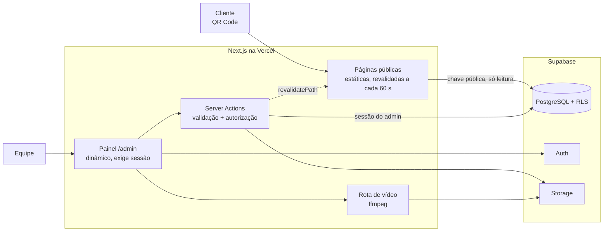

# Salgaê Lanchonete — cardápio digital

Cardápio digital de **consulta no local** para uma lanchonete: o cliente aponta a câmera para um QR Code na mesa, vê os produtos com foto, vídeo curto, preço e disponibilidade, e faz o pedido com o atendente. A equipe mantém tudo por um painel administrativo feito para o celular.

**Demonstração:** <https://salgae-producao.vercel.app> · **Stage (com conteúdo de exemplo):** <https://salgae-homologacao.vercel.app>


> Este repositório não inclui delivery, carrinho, checkout nem pagamento. O cardápio é só de consulta: _"Consulta apenas. Faça seu pedido com o atendente."_

## O que o sistema faz

**Para o cliente**

- Início com carrossel de destaques, atalhos de categoria e os mais pedidos.
- Cardápio completo por categoria, com selos (`MAIS PEDIDO`, `NOVO`, `QUENTINHO`) e itens indisponíveis sinalizados.
- Página do produto com foto, vídeo curto sem som e outros itens da mesma categoria.
- Busca por nome, ingrediente ou categoria, sem depender de acento ou maiúscula.
- Situação da loja (aberta ou fechada) calculada a partir dos horários, com horários e contatos.

**Para a equipe**

- Produtos, categorias e destaques: criar, editar, ordenar, ativar e desativar.
- Situação única por produto: no cardápio, indisponível ou oculto.
- Envio de foto e de vídeo com otimização automática.
- Dados e horários da loja, com abrir ou fechar manualmente em dois toques.
- Registro de auditoria das alterações feitas no painel.

## Tecnologias

| Camada | Tecnologia |
| --- | --- |
| Aplicação | Next.js 16 (App Router, Server Components e Server Actions), React 19, TypeScript estrito |
| Estilo | Tailwind CSS 4 |
| Dados | Supabase: PostgreSQL com Row Level Security, Auth e Storage |
| Validação | Zod, no formulário e no servidor |
| Mídia | `sharp` (WebP) e `ffmpeg` (H.264) |
| Qualidade | Vitest, ESLint, Prettier, GitHub Actions |
| Hospedagem | Vercel, um projeto por ambiente |

## Arquitetura



Organização das pastas (monorepo com npm workspaces):

```
apps/
  web/          site em Next.js: cardápio e painel (@salgae/web)
  api/          API em Hono — a caminho (Fase 2 da separação backend/frontend)
packages/
  core/         schemas Zod, tipos do banco e regras puras comuns (@salgae/core)
supabase/       migrations, seed e testes SQL (compartilhado)
docs/           documentação técnica; Salgae_Lanchonete_Obsidian/ — vault do projeto
```

Dentro de `apps/web`, o código fica em `src/`, organizado por funcionalidade:

```
src/
  app/              rotas do Next.js (páginas do cardápio, painel e a rota de vídeo)
  features/
    menu/           cardápio público
    products/       produtos
    categories/     categorias
    highlights/     destaques do banner
    store/          dados da loja e horário de funcionamento
    media/          foto e vídeo (compactação com sharp e ffmpeg)
    auth/           login e permissão de administrador
    admin/          estrutura comum do painel
  components/ui/    peças de interface comuns
  lib/              infraestrutura: Supabase, SEO, CSP, logs, QR Code, formatação
  proxy.ts          renovação da sessão, só em /admin
```

Cada funcionalidade separa o que roda no servidor do que é tela:

| Pasta | Lado | O que tem |
| --- | --- | --- |
| `server/` | back | Server Actions, leitura e gravação no Supabase, ffmpeg |
| `components/` | front | componentes React |
| `client/` | front | código do navegador sem interface (reduzir foto, validar vídeo antes de enviar) |
| `schemas/` e `rules/` | os dois | validações (zod) e regras puras, com os testes ao lado |

O `server/` de cada funcionalidade é o que vai para `apps/api` quando a API entrar.

Os testes de ponta a ponta ficam em `e2e/` (pacote `@salgae/e2e`), na raiz, porque testam o sistema inteiro.

Na raiz, `supabase/migrations` guarda o esquema, as políticas e as funções, e `supabase/tests` os testes de RLS em SQL.

## Rotas

| Rota | O que é |
| --- | --- |
| `/` | Início: destaques, categorias e mais pedidos. |
| `/cardapio` | Lista completa por categoria. |
| `/produto/[slug]` | Detalhe do item pelo nome (ex.: `/produto/coxinha-de-frango`), com vídeo opcional. Endereços antigos por id redirecionam para o novo. |
| `/busca` | Busca por nome, ingrediente ou categoria. |
| `/info` | Situação da loja, horários e contatos. |
| `/admin` | Resumo do painel e itens que precisam de atenção. |
| `/admin/produtos`, `/admin/categorias`, `/admin/destaques` | Cadastro, situação e ordenação. |
| `/admin/loja` | Dados e horários da loja. |

## Decisões técnicas

**A autorização final é do banco.** Toda ação do painel confere o administrador na aplicação (`requireAdmin`) e de novo no PostgreSQL, por políticas de RLS que consultam `private.is_admin()` — uma função fora do esquema exposto pela API. A aplicação usa só a chave pública; a `service_role` não existe no projeto. Se uma verificação da aplicação for esquecida, o banco ainda recusa a escrita.

**Páginas públicas estáticas, painel dinâmico.** O cardápio é gerado estaticamente e revalidado a cada 60 segundos; qualquer alteração no painel chama `revalidatePath` e aparece na hora. O visitante nunca espera o banco, e o cliente Supabase das páginas públicas não usa cookies, para que elas continuem podendo ser guardadas em cache. O "aberta ou fechada" é recalculado no navegador, porque uma página em cache não sabe que horas são.

**Leituras com tempo limite.** As leituras públicas são abortadas depois de 10 segundos e caem em um estado de erro com mensagem amigável. Sem isso, uma lentidão do banco travava a geração das páginas até derrubar a publicação.

**Fotos em duas variantes.** O navegador reduz a foto antes de enviar; o servidor valida pelo conteúdo, remove metadados e gera WebP `card` (até 640 px, meta de 80 KB) e `detail` (até 1600 px, meta de 300 KB). O banco guarda só a base do caminho e a interface escolhe a variante.

**Vídeo sempre leve.** O arquivo bruto vai direto do navegador para um bucket privado por URL assinada. Uma rota do servidor confere o tipo real pela assinatura do arquivo, compacta com `ffmpeg` (H.264, até 720p, sem áudio, `faststart`) e publica o resultado, tipicamente de dezenas de megabytes para 1 a 3 MB. O bruto e os temporários são apagados sempre, com sucesso ou com erro.

**Troca de mídia sem deixar item quebrado.** O arquivo novo é enviado, o registro passa a apontar para ele e só então o antigo é apagado — e apenas se nenhum outro registro o usar. Se a gravação falhar, o arquivo novo é removido e o item continua como estava (`src/features/media/server/workflow.ts`).

**Reordenação atômica.** Trocar dois itens de posição é uma única instrução no banco, por uma função SQL. Ou as duas posições mudam, ou nenhuma.

**Preço em centavos.** O preço é um inteiro (`price_cents`), sem ponto flutuante; a conversão de e para "R$ 8,90" fica em duas funções testadas.

## Qualidade

- 184 testes unitários e de integração com Vitest (`npm test`), concentrados nas regras de `src/features/` e na rota de vídeo. A cobertura é medida no CI e aparece no resumo do job: em 2026-10-14, 56% das linhas e 71% das funções do código de servidor e das regras. Um piso logo abaixo disso faz o CI falhar se a cobertura cair.
- Testes de RLS em SQL (`supabase/tests/`), que rodam dentro de uma transação desfeita no fim e conferem o que visitante, usuário comum e administrador conseguem ler e escrever.
- 56 testes de ponta a ponta com Playwright (`e2e/`): cardápio no celular e no computador, painel (categorias, destaques, loja, produtos, foto e vídeo), cache, formulários, acessibilidade com axe, menos movimento e sair, conferindo o efeito no cardápio.
- CI no GitHub Actions a cada PR, em dois jobs. O primeiro confere formatação, lint, typecheck, testes e build. O segundo sobe o Supabase local, aplica todas as migrations em um banco vazio, confere se os tipos versionados batem com esse banco, roda os testes de RLS e depois os de ponta a ponta contra o build de produção.
- Acessibilidade tratada como requisito: navegação por teclado, rótulos para leitor de tela e respeito a movimento reduzido. No Lighthouse móvel do stage, acessibilidade 100 e desempenho de 94 a 98 nas rotas públicas (medição de 2026-10-09, anterior ao redesign).
- Cabeçalhos de segurança (`Content-Security-Policy`, `HSTS`, `X-Frame-Options`, `nosniff`, `Referrer-Policy`, `Permissions-Policy`) e páginas de stage fora dos buscadores. A CSP (`src/lib/security/csp.ts`) só aceita scripts do próprio site, libera o Supabase apenas para imagens, vídeos e conexões, e os testes de ponta a ponta falham se alguma página tiver algo bloqueado por ela.
- Erros do servidor registrados como uma linha JSON (`src/lib/observability.ts`), com evento e código do erro, para filtrar nos logs da Vercel.
- Dependabot abre, toda segunda-feira, PRs de atualização para a `develop`; eles passam pelo mesmo CI.
- A renovação de sessão do Supabase (`src/proxy.ts`) roda só em `/admin`: as páginas do cardápio não fazem chamada ao Auth.

## Executar localmente

Requisitos: Node.js 22 ou superior e um projeto Supabase.

```bash
npm install
cp apps/web/.env.example apps/web/.env.local
npm run dev
```

Os comandos rodam na raiz e repassam para o pacote certo. Preencha em `apps/web/.env.local` a URL e a chave anônima/publicável do Supabase. A aplicação valida essas variáveis ao acessar o Supabase e informa claramente quando estiverem ausentes ou inválidas. Nunca coloque uma `service_role` em variáveis `NEXT_PUBLIC_`.

| Comando | Finalidade |
| --- | --- |
| `npm run dev` | Ambiente de desenvolvimento. |
| `npm run build` / `npm run start` | Build de produção e execução dele. |
| `npm run lint` | ESLint. |
| `npm run typecheck` | TypeScript estrito, sem emitir arquivos. |
| `npm test` | Testes com Vitest. |
| `npm run test:coverage` | Os mesmos testes, com medição de cobertura dos arquivos `.ts` de `src/` (relatório em `apps/web/coverage/`). |
| `npm run test:db` | Testes SQL de RLS, Storage e reordenação contra o Supabase local. |
| `npm run test:e2e` | Testes de ponta a ponta com Playwright, contra o build de produção. |
| `npm run test:types-db` | Confere os tipos versionados contra os gerados do banco local (usado no CI). |
| `npm run format` / `npm run format:check` | Formata ou confere a formatação com Prettier. |

## Banco de dados

As migrations ficam em `supabase/migrations/` e são aplicadas pelo GitHub Actions, com a CLI do Supabase: no stage, a cada merge na `develop`; em produção, por um passo manual antes da promoção, e o PR para a `main` é reprovado enquanto a produção não tiver a migration. O passo a passo e a configuração dos segredos estão em [Migrations pelo CI](docs/migrations-pelo-ci.md).

O mesmo comando funciona à mão, se for preciso:

```bash
npx supabase login
npx supabase link --project-ref <ref-do-projeto>
npx supabase db push
```

| Migration | O que faz |
| --- | --- |
| `20261008222757_initial_schema` | Categorias, produtos, destaques, perfis e auditoria, com RLS. |
| `20261008225427_harden_rls` | Move `is_admin()` para um esquema privado e deixa uma política por papel e ação. |
| `20261008232020_store_settings` | Dados únicos da loja: horários, contatos e aviso. |
| `20261009103822_product_badge` | Selos do produto. |
| `20261009121148_media_storage` | Buckets públicos de imagens e vídeos e suas políticas. |
| `20261011003026_video_compression_storage` | Bucket privado para o vídeo bruto e limite de 4 MB no publicado. |
| `20261013151000_atomic_sort_order_swap` | Funções de troca de posição em uma única instrução. |

`supabase/seed.sql` traz dados de exemplo para ambiente local ou stage. Não execute o seed em produção.

Os tipos do banco usados pelo código ficam em `apps/web/src/lib/supabase/database.types.ts`. O arquivo é gerado pelo Supabase a partir do esquema; depois de uma migration nova, gere de novo (`npx supabase gen types typescript --project-id <ref-do-projeto> > apps/web/src/lib/supabase/database.types.ts`) em vez de editar à mão. Os três clientes (`src/lib/supabase/client.ts`, `server.ts` e `public.ts`) recebem esse tipo, então um nome de tabela, coluna ou função errado vira erro no `npm run typecheck`.

### Primeiro administrador

1. Crie o usuário em **Authentication > Users** no Supabase.
2. No SQL Editor, crie o perfil inativo:

```sql
insert into public.profiles (id, name, role, is_active)
values ('UUID_DO_USUARIO', 'Nome do responsável', 'admin', false)
on conflict (id) do nothing;
```

3. Depois da conferência, ative-o:

```sql
update public.profiles
set role = 'admin', is_active = true
where id = 'UUID_DO_USUARIO';
```

Não há trigger que promova alguém automaticamente.

## Ambientes

| Ambiente | Branch | Banco | Endereço |
| --- | --- | --- | --- |
| Desenvolvimento | qualquer | stage | `npm run dev` |
| Stage | `develop` | SALGAE-STAGING | <https://salgae-homologacao.vercel.app> |
| Produção | `main` | SALGAE-PRODUCTION | <https://salgae-producao.vercel.app> |

Toda mudança entra por PR na `develop`, é conferida no stage e só então é promovida para a `main`.

## Vídeo: detalhes

| | Entrada (o que o painel aceita) | Saída (o que o cliente baixa) |
| --- | --- | --- |
| Formato | MP4, MOV (iPhone) ou WebM; H.264, HEVC, VP9… | MP4 H.264 (High, nível 3.1), 8 bits |
| Tamanho | até 50 MB | até ~3 MB para 15 s (teto de 4 MB) |
| Duração | até 15 s (tolerância de 0,5 s) | a mesma |
| Resolução | até 4K | cabe em 1280×720 ou 720×1280, sem ampliar |
| Quadros | qualquer | no máximo 30 por segundo |
| Áudio | qualquer | removido |
| Extras | HDR, rotação, GPS do celular | SDR, rotação aplicada, metadados removidos, `faststart` |

O `ffmpeg` vem do pacote `ffmpeg-static` e roda como programa separado; o binário é distribuído sob GPL. Em servidor próprio também é possível usar o do sistema: `sudo apt install ffmpeg` e `FFMPEG_PATH=/usr/bin/ffmpeg`. Na Vercel, `next.config.ts` inclui o binário no pacote da rota e a rota declara `maxDuration = 180`. A foto continua obrigatória: é a capa do vídeo.

## Mais documentação

- [Guia da equipe](docs/guia-da-equipe.md) — como usar o painel no dia a dia.
- [Publicação em produção](docs/publicacao-producao.md) — passo a passo de migrations, variáveis e conferência.
- [Migrations pelo CI](docs/migrations-pelo-ci.md) — como o GitHub Actions aplica as migrations no stage e na produção.
- [Resultados de testes](docs/testes/) — planos e medições de cada entrega.
- `Salgae_Lanchonete_Obsidian/` — visão do produto, decisões, modelo de dados e identidade visual, em notas do Obsidian.
