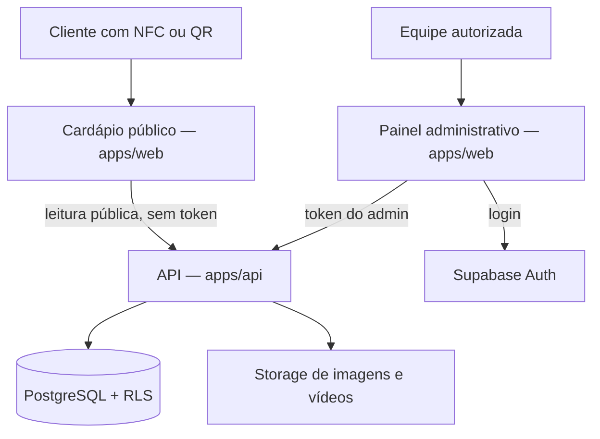

---
titulo: "Arquitetura e stack"
area: Tecnologia
tags:
  - tecnologia
  - arquitetura
atualizado: 2026-10-31
---
# Arquitetura e stack

Voltar: [[00-Comece-Aqui]] · Deploy: [[09-Ambientes-e-Deploy]]

## Arquitetura em alto nível

> **Atualizado em 2026-10-31 (plano v3, [[25-Mudanca-Separar-Backend-e-Frontend]]):** o backend saiu do Next. O site (`apps/web`) só desenha a tela; a API própria (`apps/api`, Hono) é a única peça que lê e grava no Supabase; o que os dois compartilham fica em `packages/core`. Detalhes, camadas e convenção de nomes no `README.md` do repositório.

O cardápio público lê apenas dados permitidos, pela API e sem token. O painel escreve pela API com o token do administrador, e a API cria um cliente Supabase por requisição com esse token: as políticas de autorização (RLS) continuam sendo a última barreira. O Supabase é a fonte de verdade de dados e imagens.

Dentro da API, cada domínio (`menu`, `products`, `categories`, `highlights`, `store`, `media`) tem quatro camadas: `routes → controller → service → repository`. O service guarda a regra e define a interface do repositório; o repository é o único que conhece o Supabase.

## Tecnologias definidas

| Camada | Tecnologia | Uso |
| --- | --- | --- |
| Banco de dados | Supabase PostgreSQL | Produtos, categorias, destaques, usuários e auditoria. |
| Autenticação | Supabase Auth | Sessões e identidade dos usuários administrativos. |
| Arquivos | Supabase Storage | Fotos e vídeos curtos de produtos e artes de destaque. |
| API | Hono (Node.js 22) | Leituras públicas e escritas do painel; roda na Vercel ou em Docker numa VPS. |
| Hospedagem | Vercel | Site e API, com projetos independentes por ambiente. |
| Movimento | Motion (`motion/react-m`) | Carrossel, cardápio, barra inferior, busca e camadas do painel, respeitando "menos movimento". |
| Testes | Vitest, Playwright e axe | Unidade (API, site e core) e ponta a ponta com acessibilidade. |
| Controle de versão | Git/GitHub | Histórico, revisão e fluxo entre `develop` e `main`. |

## Base de aplicação recomendada

Para uma aplicação única com área pública e painel, a base recomendada é **Next.js com TypeScript**, estilização com **Tailwind CSS** e validação com **Zod**. Isso ainda deve ser confirmado como decisão final antes de iniciar a implementação; se outra stack for escolhida, atualize [[03-Decisoes-do-Projeto]].

O motivo da recomendação é manter interface, rotas protegidas, validação e deploy no mesmo projeto, sem introduzir servidor próprio onde ele não é necessário no MVP.

## Princípios técnicos

- Nunca colocar chaves administrativas do Supabase no navegador.
- Separar funções públicas, administrativas e sensíveis.
- Validar no cliente para orientar o usuário e no servidor/banco para garantir integridade.
- Tratar operações de imagem, vídeo e exclusão como ações com verificação.
- Usar tipagem e regras de domínio para preço, ordenação e disponibilidade.
- Preferir componentes acessíveis e responsivos desde a primeira tela.

## Integrações futuras possíveis

WhatsApp, chamada de atendente, métricas e pedido digital podem ser adicionados depois como módulos. Eles não devem moldar a arquitetura atual a ponto de atrasar o cardápio local.
