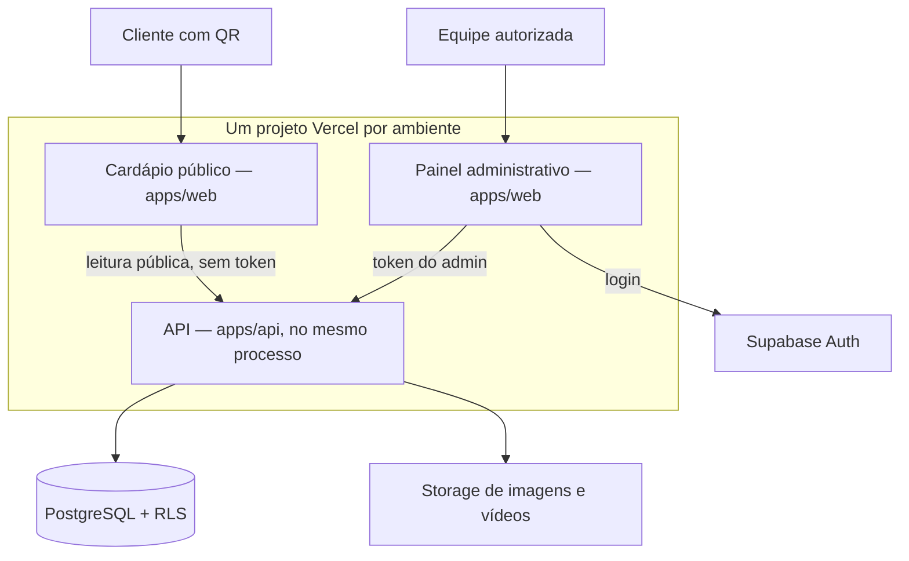

---
titulo: "Arquitetura e stack"
area: Tecnologia
tags:
  - tecnologia
  - arquitetura
atualizado: 2026-11-15
---
# Arquitetura e stack

Voltar: [[00-Comece-Aqui]] · Deploy: [[09-Ambientes-e-Deploy]]

## Arquitetura em alto nível

> **Atualizado em 2026-11-15:** o site (`apps/web`) só desenha a tela; a API própria (`apps/api`, Hono) é a única peça que lê e grava no banco e quem processa e publica a mídia no Storage (só o vídeo bruto sobe do navegador direto ao Storage, por URL assinada criada pela API); o que os dois compartilham fica em `packages/core`. Desde 2026-11-03, a API roda **dentro do site**, no mesmo processo, em um projeto Vercel por ambiente, e também responde em `/api`. Desde 2026-11-15 (PR #94), o **vídeo também passa pela API**: a rota `/admin/midia/video` do Next só repassa o pedido, porque a compactação precisa de uma função de até 180 s com o binário do `ffmpeg`. Decisões em [[03-Decisoes-do-Projeto]]; detalhes, camadas e convenção de nomes no `README.md` do repositório.

O cardápio público lê apenas dados permitidos, pela API e sem token. O painel escreve pela API com o token do administrador, e a API cria um cliente Supabase por requisição com esse token: as políticas de autorização (RLS) continuam sendo a última barreira. O Supabase é a fonte de verdade de dados e imagens.

Dentro da API, cada domínio (`menu`, `products`, `categories`, `highlights`, `store`, `media`, `session`, `health`) tem quatro camadas: `routes → controller → service → repository`. O service guarda a regra e define a interface do repositório; o repository é o único que conhece o Supabase. Foto e vídeo ficam em `modules/media/`, com uma regra única para apagar a mídia que nenhum registro usa.

O `/api/health` consulta o banco. É ele que o workflow **Ambientes no ar** chama a cada 2 dias ([[09-Ambientes-e-Deploy]]).

## Tecnologias definidas

| Camada | Tecnologia | Uso |
| --- | --- | --- |
| Banco de dados | Supabase PostgreSQL | Produtos, categorias, destaques, usuários e auditoria. |
| Autenticação | Supabase Auth | Sessões e identidade dos usuários administrativos. |
| Arquivos | Supabase Storage | Fotos e vídeos curtos de produtos e artes de destaque. |
| API | Hono (Node.js 22) | Leituras públicas, escritas do painel, foto e vídeo; roda dentro do site e tem `Dockerfile` para servidor separado. |
| Hospedagem | Vercel (Hobby) | Um projeto por ambiente, com site e API juntos e funções em São Paulo (`gru1`). |
| Mídia | `sharp` e `ffmpeg` | Foto em WebP e vídeo em MP4 H.264, processados pela API ([[08-Imagens-e-Storage]]). |
| Movimento | Motion (`motion/react-m`) | Carrossel, cardápio, barra inferior, busca e camadas do painel, respeitando "menos movimento". |
| Testes | Vitest, Playwright e axe | Unidade (API, site e core) e ponta a ponta com acessibilidade. |
| Controle de versão | Git/GitHub | Histórico, revisão e fluxo entre `develop` e `main`. |

## Base de aplicação recomendada

A base é **Next.js com TypeScript**, estilização com **Tailwind CSS** e validação com **Zod**, confirmada em 2026-10-08 ([[03-Decisoes-do-Projeto]]). A ideia de manter interface, rotas protegidas e deploy no mesmo projeto continua: mesmo com a API separada em `apps/api`, cada ambiente publica um projeto só.

## Princípios técnicos

- Nunca colocar chaves administrativas do Supabase no navegador.
- Separar funções públicas, administrativas e sensíveis.
- Validar no cliente para orientar o usuário e no servidor/banco para garantir integridade.
- Tratar operações de imagem, vídeo e exclusão como ações com verificação.
- Usar tipagem e regras de domínio para preço, ordenação e disponibilidade.
- Preferir componentes acessíveis e responsivos desde a primeira tela.
- Cache das leituras públicas: as páginas do site chamam a API embutida dentro do próprio servidor e são renovadas na hora em que o painel salva (`updateTag`). Já quem chama `/api/health`, `/api/v1/menu` e `/api/v1/store` por HTTP recebe `Cache-Control: public, s-maxage=60, stale-while-revalidate` (`apps/api/src/shared/http/public-cache.ts`): a CDN da Vercel pode entregar dado com até 60 s de atraso (mais um tempo curto de revalidação). Isso é esperado; não usar essas rotas para conferir uma mudança recém-salva.

## Integrações futuras possíveis

WhatsApp, chamada de atendente, métricas e pedido digital podem ser adicionados depois como módulos. Eles não devem moldar a arquitetura atual a ponto de atrasar o cardápio local.
